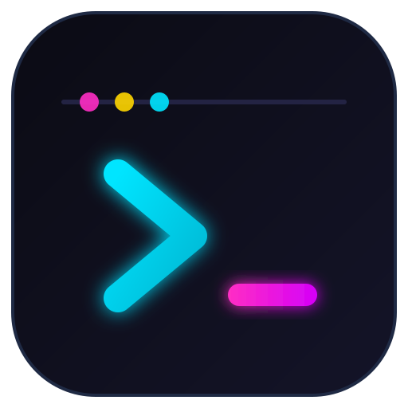
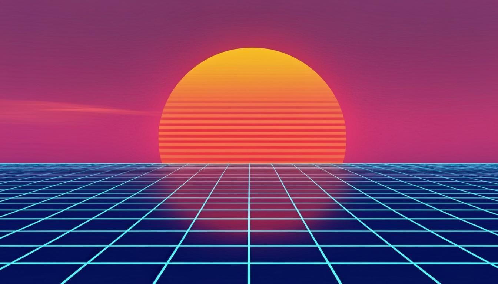
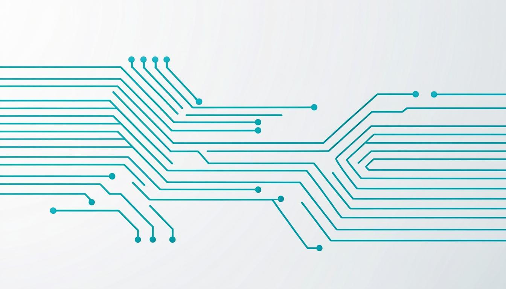

<div align="center">



# Carsai OS

**A lightweight, Debian-based Linux distribution with a tech/neon identity.**

[](https://github.com/carsaimz/carsai-os/actions/workflows/build-iso.yml)


[](README.pt.md)

</div>

---

**Carsai OS** is a custom Linux distribution derived from **Debian Stable**, designed to run comfortably on machines with **less than 4 GB of RAM**, wrapped in a modern, immersive **tech / cyberpunk / neon** visual identity.

It does not try to compete with general-purpose distros on feature count. The goal is a **cohesive, stylish and efficient** experience on modest hardware, with a planned path for **Windows (.exe)** and **Android (.apk)** application compatibility.

> "Carsai" is the umbrella name of the project (**Carsai Mozambique**) and has no relation to AI. Artifacts may be named *Carsai OS* (product) or *Carsai LinuOs* (variant); the prefix is the identity.

## Goals

| Metric | Target |
| --- | --- |
| Idle RAM usage (XFCE session) | ≤ 600 MB |
| Minimum RAM for install / basic use | 1 GB |
| Comfortable RAM | 2–4 GB |
| Architecture (initial) | 64-bit (amd64) |
| Base | Debian 12 "Bookworm" |
| Desktop | XFCE (main), LXQt (future alternative) |

For the rationale and benchmarks behind these targets, see the [documentation](docs/README.md).

## Theme gallery (pre-installed)

The default theme is **Carsai Neon**. Three more complete themes ship with the system and can be switched with the built-in theme selector.

| Theme | Mood |
| --- | --- |
| **Carsai Neon** (default) | Dark, cyan/magenta accents, subtle glow, monospace titles |
| **Carsai Dark Minimal** | Sober dark, for productivity |
| **Carsai Retrowave** | Synthwave / outrun gradients |
| **Carsai Light Tech** | Light with tech accents, for bright rooms |

| Neon | Dark Minimal |
| --- | --- |
|  |  |
| **Retrowave** | **Light Tech** |
|  |  |

## Repository layout

```
carsai-os/
├── build/live/          # live-build configuration (ISO recipe)
├── branding/            # logo + wallpapers
├── docs/                # technical documentation (Portuguese)
├── scripts/             # build-iso.sh, install-themes.sh
└── themes/              # GTK themes, terminal schemes, theme selector
```

## Build the ISO yourself

Requirements: any Linux host with Docker or root, ~15 GB free disk, internet.

```bash
git clone https://github.com/carsaimz/carsai-os.git
cd carsai-os
sudo apt-get install -y live-build debootstrap squashfs-tools xorriso
./scripts/build-iso.sh
# ISO lands in build/live/*.iso
```

The GitHub Actions workflow (**Build ISO**) produces the same artifact on every push to `main` that touches `build/`, `themes/` or `branding/` — download it from the *Actions* tab (*Artifacts*, kept for 7 days).

## Test in a virtual machine

```bash
qemu-system-x86_64 -m 2048 -enable-kvm -cdrom build/live/carsai-os-*.iso
```

## Roadmap

- [x] Project scaffold: documentation, live-build config, themes, branding, CI
- [ ] **Phase 1 — Base**: bootable ISO, ≤ 600 MB idle (XFCE + Carsai Neon)
- [ ] **Phase 2 — Identity**: packaged themes, icons, wallpapers, selector; VM tests at 2 GB / 4 GB
- [ ] **Phase 3 — Wine**: Wine + Bottles/Lutris pre-installed, documented limits
- [ ] **Phase 4 — Waydroid**: evaluate Wayland maturity on XFCE/Debian; optional "Carsai Android"
- [ ] **Phase 5 — Refinement**: stress tests on real 2 GB / 4 GB hardware, service tuning, user docs

Details in [docs/07-roadmap.md](docs/07-roadmap.md).

## Documentation

The technical documentation is written in Portuguese:

1. [Visão geral e filosofia](docs/01-visao-geral.md)
2. [Requisitos de sistema e escolha da base](docs/02-requisitos-sistema.md)
3. [Sistema de temas (identidade visual)](docs/03-temas.md)
4. [Compatibilidade com Windows (.exe)](docs/04-compatibilidade-windows.md)
5. [Compatibilidade com Android (.apk)](docs/05-compatibilidade-android.md)
6. [Decisões de arquitectura (o que não fazer)](docs/06-arquitetura-decisoes.md)
7. [Roteiro de implementação](docs/07-roadmap.md)

## Contributing

Pull requests are welcome! Read [CONTRIBUTING.md](CONTRIBUTING.md) first (commit conventions, how to test, repo areas).

## License

[MIT](LICENSE) © Carsai Mozambique (CarsaiMz)

Upstream work (Debian, XFCE, live-build, ...) keeps its own licenses.
