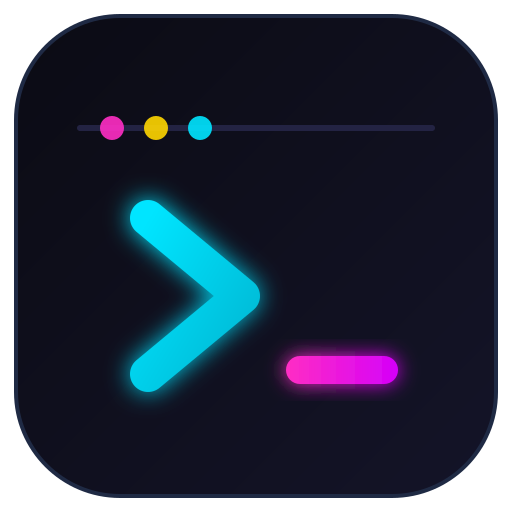
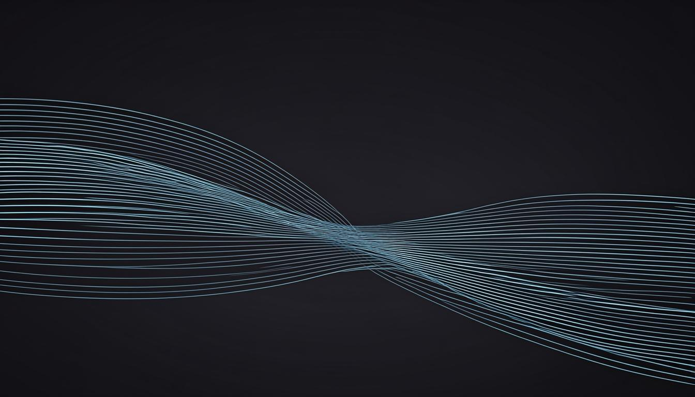
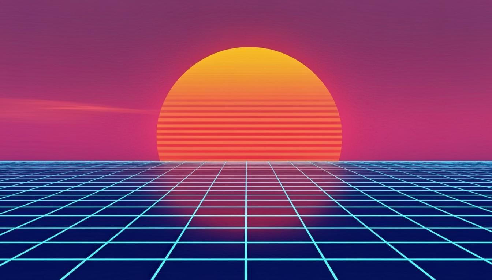
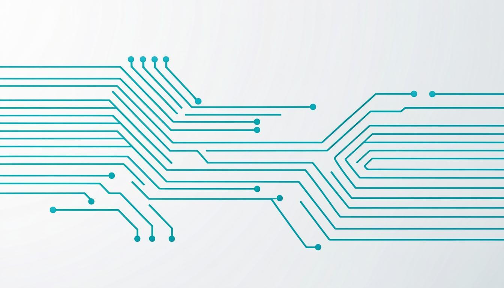

<div align="center">



# Carsai OS

**Uma distribuição Linux leve, baseada em Debian, com identidade tech/neon.**

[](https://github.com/carsaimz/carsai-os/actions/workflows/build-iso.yml)


[](README.md)

</div>

---

O **Carsai OS** é uma distribuição Linux personalizada, derivada do **Debian Stable**, projectada para rodar confortavelmente em máquinas com **2–4 GB de RAM**, com uma identidade visual moderna e imersiva (**tech / cyberpunk / néon**).

Não é objectivo competir com distros generalistas em quantidade de recursos: a meta é uma experiência **coesa, estilosa e eficiente** em hardware modesto, com um caminho planeado para compatibilidade com aplicações **Windows (.exe)** e **Android (.apk)**.

> "Carsai" é o guarda-chuva do projecto (**Carsai Mozambique**) e não tem relação com IA. Os artefactos podem chamar-se *Carsai OS* (produto) ou *Carsai LinuOs* (variação); o prefixo é a identidade.

## Metas

| Métrica | Alvo |
| --- | --- |
| Consumo de RAM em idle (sessão XFCE) | ≤ 800 MB |
| RAM mínima para instalação / uso básico | 2 GB |
| RAM recomendada | 4 GB |
| Arquitectura (inicial) | 64 bits (amd64) |
| Base | Debian 12 "Bookworm" |
| Ambiente gráfico | XFCE (principal), LXQt (alternativa futura) |

A justificação e os dados por detrás destes alvos estão na [documentação](docs/README.md).

## O que vem na caixa (v0.1.0-alpha)

- **Shell estilo Windows, estética hacker** — menu iniciar com o ícone Carsai,
  dock/taskbar, `Win+E` / `Win+R` / `Win+D` / `Win+L` / `Win+V`, snap de
  janelas com `Win+setas`, workspaces via `Ctrl+Win+setas` ou `Win+1..4`,
  gestor de tarefas em `Ctrl+Alt+Del`, variantes do PrintScreen (capítulo
  completo: [docs/08](docs/08-shell-atalhos-e-statusbar.md)).
- **Statusbar rico** — painel superior com CPU %, RAM % e rede ↓/↑ em tempo
  real (feed genmon sem dependências), barras de carga, bandeja, volume,
  relógio com segundos, pager de workspaces.
- **Suporte a .exe de fábrica** — Wine 64 bits **e 32 bits** (multiarch i386
  construído na ISO), winetricks, fontes; `carsai-exe app.exe` no terminal ou
  duplo clique no Thunar.
- **Caminho Android** — instalador num comando (`scripts/install-waydroid.sh`)
  mais o launcher `carsai-android` (janela aninhada estilo telefone no X11).
- **Decorações xfwm4 néon** — barras de título e botões gerados, acentos
  idênticos aos de cada um dos 4 temas (GTK e janelas trocam juntos).
- **Boas-vindas no primeiro boot** — banner ASCII com neofetch, cola de
  atalhos e dicas dos comandos Carsai; aparece uma vez, nunca mais.
- **Ferramentas hacker pré-instaladas** — btop, neofetch, tmux, ranger, ncdu,
  cmatrix, xdotool, wmctrl, mais Firefox ESR como navegador.

## Releases

Cada tag git compila uma ISO de release automaticamente:

```bash
git tag v0.1.1-alpha && git push origin v0.1.1-alpha
# o workflow "Release ISO" anexa carsai-os-<versão>-amd64.iso + .sha256
# ao GitHub Release dessa tag
```

A imagem mais recente está na [página de Releases](https://github.com/carsaimz/carsai-os/releases). Código sem tag continua a produzir um artefacto de 7 dias no workflow *Build ISO*.

## Galeria de temas (pré-instalados)

O tema padrão é o **Carsai Neon**. Outros três temas completos vêm com o sistema e podem ser trocados com o seletor de temas integrado.

| Tema | Estética |
| --- | --- |
| **Carsai Neon** (padrão) | Escuro, acentos ciano/magenta, brilho subtil, títulos monoespaçados |
| **Carsai Dark Minimal** | Escuro sóbrio, para produtividade |
| **Carsai Retrowave** | Gradientes synthwave / outrun |
| **Carsai Light Tech** | Claro com acentos tech, para ambientes iluminados |

| Neon | Dark Minimal |
| --- | --- |
|  |  |
| **Retrowave** | **Light Tech** |
|  |  |

## Estrutura do repositório

```
carsai-os/
├── build/live/          # configuração live-build (receita da ISO)
├── branding/            # logo, wallpapers, arte ASCII
├── docs/                # documentação técnica (português)
├── scripts/             # build-iso.sh, install-themes.sh, Waydroid, scripts do sistema
└── themes/              # temas GTK + xfwm4, esquemas de terminal, seletor de temas
```

## Construir a ISO

Requisitos: um Linux hospedeiro com Docker ou root, ~15 GB livres de disco e internet.

```bash
git clone https://github.com/carsaimz/carsai-os.git
cd carsai-os
sudo apt-get install -y live-build debootstrap squashfs-tools xorriso
./scripts/build-iso.sh
# A ISO fica em build/live/*.iso
```

O workflow do GitHub Actions (**Build ISO**) produz o mesmo artefacto a cada push em `main` que toque em `build/`, `themes/` ou `branding/` — descarrega-o no separador *Actions* (*Artifacts*, guardados 7 dias).

## Testar numa máquina virtual

```bash
qemu-system-x86_64 -m 2048 -enable-kvm -cdrom build/live/carsai-os-*.iso
```

## Roteiro

- [x] Scaffold do projecto: documentação, config live-build, temas, branding, CI
- [x] **Fase 1 — Base**: ISO bootável compilada no CI (build verde, artefacto)
- [x] **Fase 2 — Identidade**: 4 temas (GTK + xfwm4), wallpapers, seletor,
      statusbar rico + dock, atalhos estilo Windows, banner de boas-vindas
- [x] **Fase 3 — Wine**: Wine 32+64 bits pré-instalado, carsai-exe, limitações documentadas
- [ ] **Fase 4 — Waydroid**: script de instalação pronto; avaliar em XFCE com Wayland real
- [ ] **Fase 5 — Refinamento**: testes em hardware real com 2 GB / 4 GB, ajuste de serviços, docs do utilizador

Detalhes em [docs/07-roadmap.md](docs/07-roadmap.md).

## Documentação

A documentação técnica está escrita em português:

1. [Visão geral e filosofia](docs/01-visao-geral.md)
2. [Requisitos de sistema e escolha da base](docs/02-requisitos-sistema.md)
3. [Sistema de temas (identidade visual)](docs/03-temas.md)
4. [Compatibilidade com Windows (.exe)](docs/04-compatibilidade-windows.md)
5. [Compatibilidade com Android (.apk)](docs/05-compatibilidade-android.md)
6. [Decisões de arquitectura (o que não fazer)](docs/06-arquitetura-decisoes.md)
7. [Roteiro de implementação](docs/07-roadmap.md)
8. [Shell: atalhos, statusbar e a experiência Windows + Android](docs/08-shell-atalhos-e-statusbar.md)

## Contribuir

Pull requests são bem-vindos! Lê primeiro o [CONTRIBUTING.md](CONTRIBUTING.md) (convenções de commit, como testar, áreas do repositório).

## Licença

[MIT](LICENSE) © Carsai Mozambique (CarsaiMz)

O trabalho a montante (Debian, XFCE, live-build, ...) mantém as suas próprias licenças.
